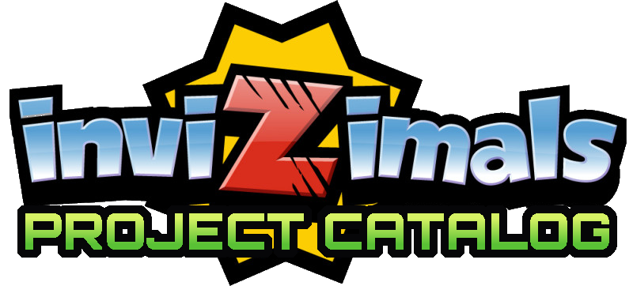
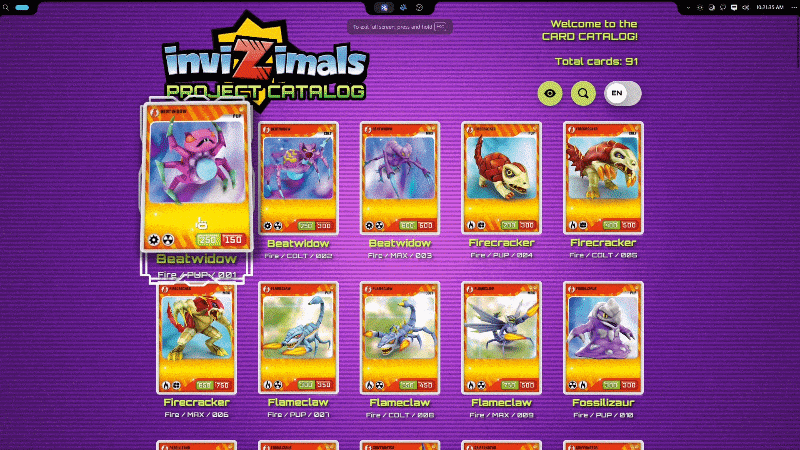

<p align="center">
    
    <br>
</p>

# 🌌 Invizimals: Project Catalog

**Welcome to Invizimals Universe!**  
This is a project by the community and for the community, which revives the Invizimals saga on the web with a modern, interactive style.



---

## 🎮 Description

This project is an **interactive encyclopedia of cards** from the **Hidden Challenges** generations

Main features:

- **Hidden Challenges** cards of the Fire and Ice habitats, as well as Dragon and Legendary types.
- Steam trading cards inspired hover effects!
- Invizimals: Shadow Zone inspired theme!

---

## 💾 Data Structure
```JSONC
{
    // JSON data of entire catalog
    "catalog": {
        "total_cards": 144,
        "total_types": [
            {
                "type": "fire",
                "total": 44
            },
            {
                "type": "ice",
                "total": 47
            },
            {
                "type": "desert",
                "total": 53
            }
        ]
    },

    // Series has its own array of Invizimals
    "series": {
        "Hidden_Challenges": [
            {
                "id": 1,
                "name": "Beatwidow",
                "type": "Fire / PUP / 001",
                "image": "Assets/Hidden_Challenges/Types/FIRE/Art/01/frontal.png",
                "image2": "Assets/Hidden_Challenges/Types/FIRE/Art/01/personaje.png",
                "arImage": "Assets/Hidden_Challenges/Types/FIRE/Art/01/ar.png",
                "description": "A dancing spider? This Invizimal world is full of surprises! I present Beatwidow, the queen of the disco, who can break dance or as a robot... Whatever you want!! This creature is such a good dancer that she has a disco ball in her stomach. By the way, watch that ball... maybe you can use it in more... dangerous ways!",
                "stat": "285 / 150",
                "habitats": "FIRE"
            },
            ...
        ]
    }
}
```

## 📁 Project Structure

```bash
root
├── index.html ← The card catalog web page.
├── invizimals.json ← The data that index.html reads.
│
├── Assets ← All the art and AR card assets.
│   ├── Hidden_Challenges
│   │   └── Types
│   │       ├── FIRE/
│   │       │   ├── Art/ ← The images of cards.
│   │       │   └── PDF/ ← Compiled art and AR cards.
│   │       ├── ICE/
│   └── ...
│
└── src ← Other graphical assets for the web page.
    ├── Fonts
    └── ...

```
## 🌟 Next Steps

- Add all the Invizimals of other elements in **Hidden Challenges**.
- Build filters that will allow you to select an element in order to view cards that interest you.
- Build a search engine to filter by the name of each **Invizimals**.
- Add other Invizimals from other series.

## 👥 Credits
- Cards by [u/HeavyEquivalent479](https://www.reddit.com/user/HeavyEquivalent479/), see [Drive](https://drive.google.com/drive/folders/1GnVYD49PDrJ74yKlt0Vd2FLydV79ETov)
- Card data reference from [u/Organic_Woodpecker64](https://www.reddit.com/user/Organic_Woodpecker64/), see [Spreadsheet](https://onedrive.live.com/:x:/g/personal/DD980C6F23226519/EXIzvOUrS0RHhmyvIVfMb6wBiBmZzQUIT1Fjm6vszJdMqg?resid=DD980C6F23226519!se5bc33724b2b4744866caf2157cc6fac&ithint=file%2Cxlsx&e=noYxr9&migratedtospo=true&redeem=aHR0cHM6Ly8xZHJ2Lm1zL3gvYy9kZDk4MGM2ZjIzMjI2NTE5L0VYSXp2T1VyUzBSSGhteXZJVmZNYjZ3QmlCbVp6UVVJVDFGam02dnN6SmRNcWc_ZT1ub1l4cjk)
- Project started by [r4nc0x](https://github.com/r4nc0x), see [Repository](https://github.com/r4nc0x/proyecto_Invizimals)
- The rest of Ice Invizimal cutouts and some Fire types were edited by me (Jelly).

## 📌 License

This project is free to use and modify however you want for personal projects, but don't use it for any monetary gain.

This project and its contents are not affiliated with, endorsed by, and/or maintained by **Sony Computer Entertainment America LLC**, **Novarama**, nor **PANINI**.

All rights reserved of the original, unedited files and properties of Invizimals to its legal creators and owners.

Orbitron font, Copyright 2018 The Orbitron Project Authors: [Open Font License](RESOURCES/Fonts/Orbitron/OFL.txt)